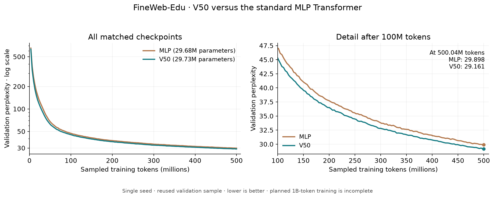
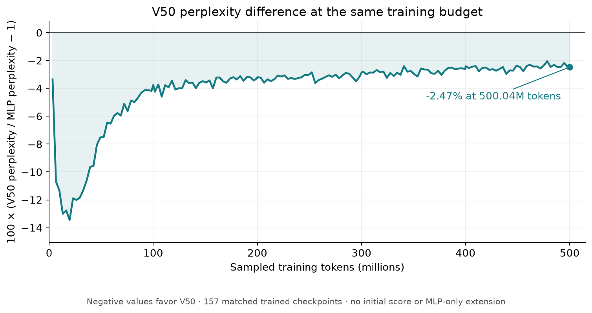
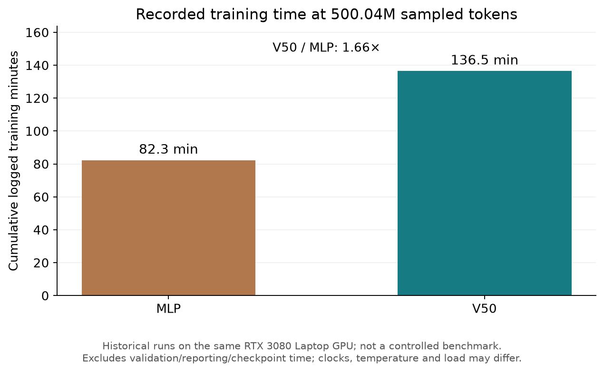

# V50 resident fields vs. a standard Transformer MLP

A reproducible research snapshot comparing two approximately 30-million-parameter causal language models on a prepared FineWeb-Edu corpus. V50 replaces each block's conventional feed-forward MLP with distance-gated resident responses. Attention, model width, depth, context length, tokenizer and training-token budget are shared.

**At 500,039,680 training tokens, V50 reaches validation perplexity 29.161 versus 29.898 for the MLP baseline: 2.47% lower, with 0.17% more parameters.** This is one seed on reused development validation, not an independent test-set or multi-seed claim.

The accuracy improvement has a cost: cumulative recorded training time at that budget was about **1.66× higher for V50** (8,191.56 seconds versus 4,939.44 seconds). These are historical trainer timings, excluding evaluation/reporting, rather than a controlled hardware benchmark.



## Results at equal training budgets

| Training tokens | MLP perplexity | V50 perplexity | V50 relative difference |
|---:|---:|---:|---:|
| 19,660,800 | 152.057 | 131.619 | −13.44% |
| 100,007,936 | 47.066 | 45.300 | −3.75% |
| 200,015,872 | 37.711 | 36.506 | −3.20% |
| 300,023,808 | 33.785 | 32.816 | −2.87% |
| 400,031,744 | 31.501 | 30.744 | −2.40% |
| 500,039,680 | 29.898 | 29.161 | −2.47% |

Lower is better. These are the **fresh runs using a 1-billion-token learning-rate schedule**, not curves spliced onto earlier short pilots. Both models started from scratch with seed 1337. The plotted comparison stops at their last common validation point, update 15,260. Neither curve establishes a completed 1B-token comparison. Random-window training can revisit text; the budget counts processed token targets, not unique corpus coverage.



The underlying [validation measurements](results/validation.csv), [training measurements](results/training.csv), [summary](results/summary.json) and [protocol](results/protocol.json) are included. Regenerate the figures with `python scripts/plot_results.py`.

## What changes in the model?

| Component | Standard MLP | V50 |
|---|---|---|
| Transformer blocks / token width | 8 / 512 | 8 / 512 |
| Causal attention heads / context | 8 / 512 tokens | 8 / 512 tokens |
| Feed-forward branch | 512 → 2048 → 512, GELU | Four 128D routing spaces; 109 residents per space |
| Resident response | — | Four full-width input/output channels per resident |
| Total trainable parameters | 29,676,544 | 29,726,752 |
| Resident position optimizer | — | Tangent AdamW with sphere retraction |

Both use pre-normalization, learned positional embeddings, tied token/output embeddings, an 8,192-token vocabulary and zero dropout. A shared seed does not imply identical initial tensors across different architectures.

For the MLP, the branch is `down(GELU(up(h)))`. In V50, each resident has a normalized position, learned radius, four input feature vectors and four output vectors. A learned token projection determines its distance gate; all response channels read and write the full 512D representation. The gate weights a resident's nonlinear content response before the outputs are summed. **V50 halves the resident output weights only at initialization**; there is no permanent half-scale in the forward pass.

See [the architecture and equations](docs/architecture.md) and the portable source bundles in [models/v50](models/v50) and [models/mlp](models/mlp).

## Findings and limits

- V50 learns faster in token terms early in these runs. Its advantage narrows from 13.44% at approximately 20M tokens to 2.47% at approximately 500M.
- The advantage remains at the later matched checkpoints shown above. It does not establish what happens after a completed 1B-token run, on other datasets, or across seeds.
- Parameter counts are close, but compute is not matched. V50 took about 1.66× the recorded training time. It still evaluates resident responses densely, including responses whose gates become zero. These results establish no sparse-inference or speed advantage.
- This compares the complete model/training recipes. V50's spherical position optimizer and specialized clipping are part of its recipe, so the outcome does not isolate the architecture from optimization.
- Validation windows have been reused during architecture research. The separately prepared test split was not used for these published measurements. No confidence intervals are available from a single seed.



## Reproduce

Python 3.12 and a CUDA GPU supporting BF16 were used for the recorded runs. Install the [recorded dependencies](requirements.txt) in a fresh environment; select the appropriate PyTorch CUDA wheel for your machine. The original runs used PyTorch 2.7.1+cu128 and enabled TF32. Results from different hardware/software may not be bitwise identical.

```bash
python -m venv .venv
source .venv/bin/activate
pip install -r requirements.txt
python -m unittest discover -s tests -v
python scripts/plot_results.py
```

Prepare the corpus using the [data instructions](docs/data.md). From the repository root, run either model separately:

```bash
python models/mlp/train.py --train \
  --data-dir data/fineweb-edu-1b-v1 --run-dir runs/mlp \
  --tokens 1000000000 --max-steps 15260 --seed 1337 \
  --microbatch 16 --lr 0.0003 --min-lr 0.00003 \
  --warmup-steps 100 --weight-decay 0.1 --eval-every 100 --device cuda

python models/v50/train.py --train \
  --model-config configs/v50.json \
  --data-dir data/fineweb-edu-1b-v1 --run-dir runs/v50 \
  --tokens 1000000000 --max-steps 15260 --seed 1337 \
  --microbatch 16 --lr 0.0003 --min-lr 0.00003 \
  --warmup-steps 100 --weight-decay 0.1 --eval-every 100 --device cuda \
  --position-direction-lr-scale 0.8671654817246768
```

The effective batch is 16 sequences × 512 tokens × 4 accumulation steps = 32,768 targets per update. `--tokens 1000000000` retains the original 30,518-update cosine schedule; `--max-steps 15260` pauses at the comparison endpoint. Do not shorten `--tokens` to 500M: that would change the learning-rate schedule. To continue a saved run, add `--resume` and increase or omit `--max-steps`, keeping the same run directory, original token horizon and recipe. Its data directory and metadata identity must stay unchanged. For a short smoke run, use a smaller `--max-steps`, keeping the original token horizon.

Full training is not run by the tests. Model weights and raw training documents are not included. The [code provenance record](docs/code-provenance.json) distinguishes the frozen experimental sources from small portability/metadata edits in this export.

## Data attribution

FineWeb-Edu is provided by Hugging Face under ODC-BY. This experiment uses the first two ordered shards of the pinned `sample-10BT` source pool, preparing approximately 1B training tokens rather than the entire FineWeb-Edu collection. See the [pinned dataset card](https://huggingface.co/datasets/HuggingFaceFW/fineweb-edu/blob/87f09149ef4734204d70ed1d046ddc9ca3f2b8f9/README.md), [FineWeb paper](https://arxiv.org/abs/2406.17557), and [source manifest](data/source-manifest.json).
