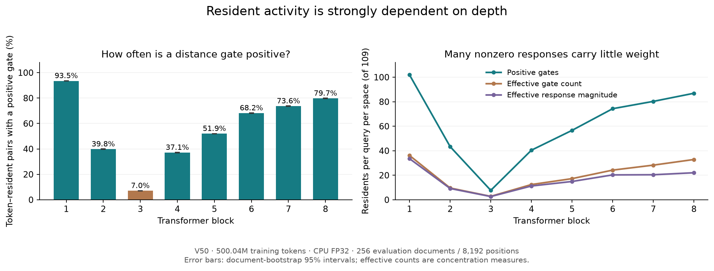
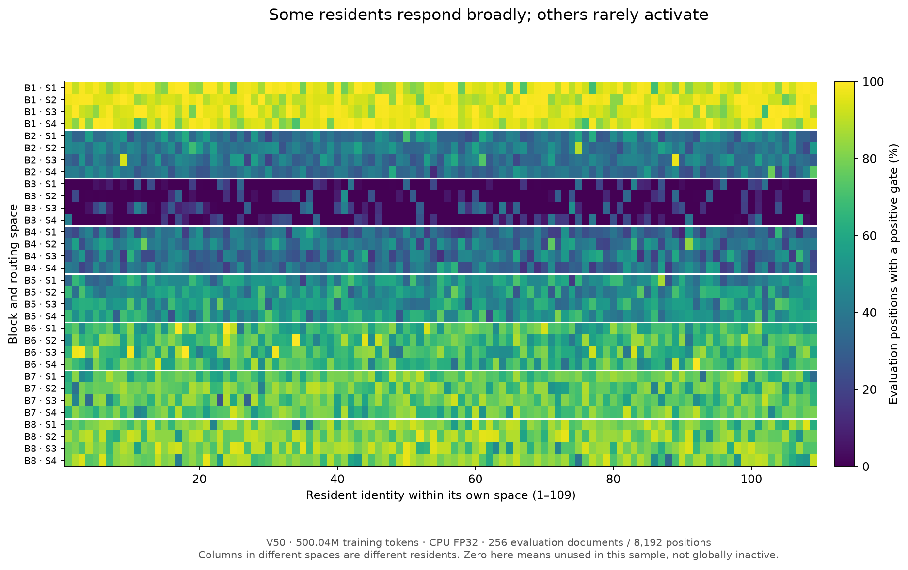
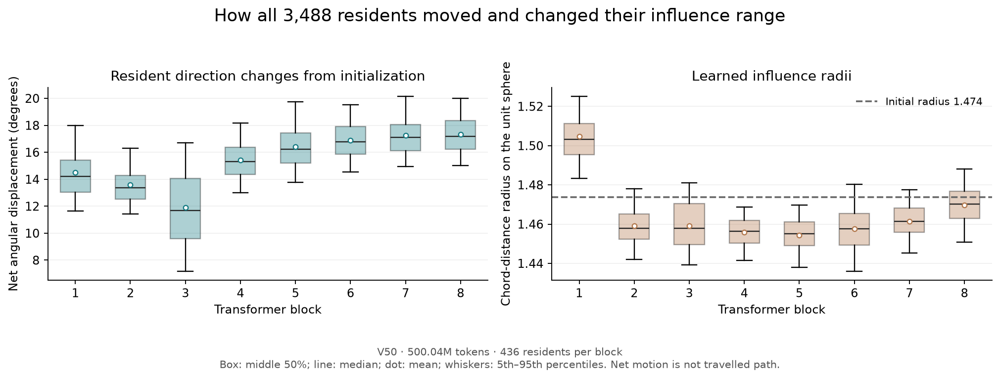
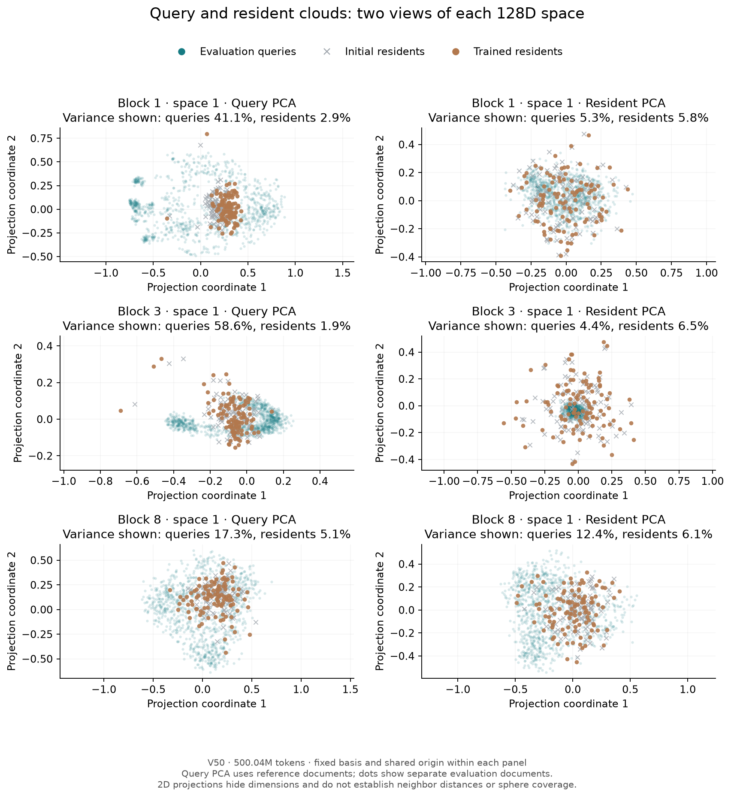
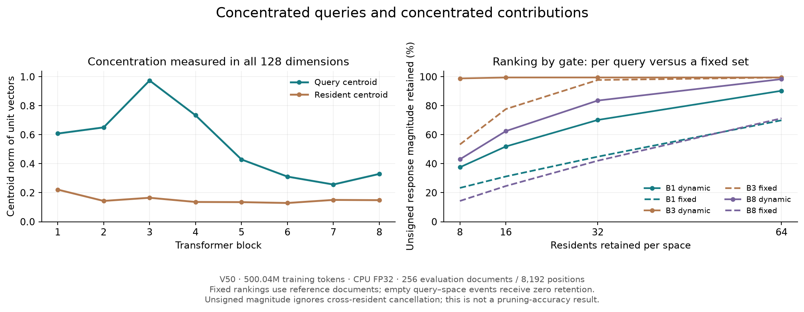
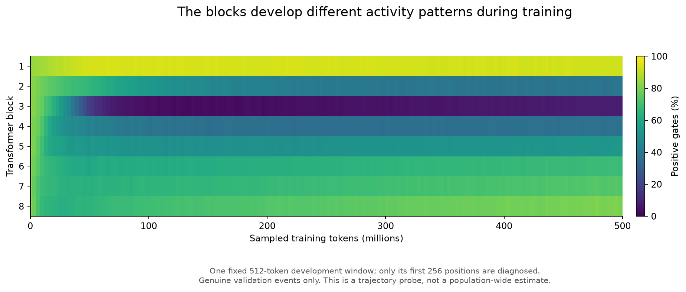

# Inside V50: resident activity, movement, and geometry

These measurements use **the same V50 checkpoint as the main comparison: update 15,260, after 500,039,680 training tokens**. The model was frozen throughout. No training or parameter changes were performed.

The main observation is strong variation between blocks: some use almost every resident, while block 3 routes most inputs to a small subset. Even where many gates are positive, the response magnitude concentrates on fewer residents.

## Snapshot statistics

| Measurement | Result | Interpretation |
|---|---:|---|
| Total residents | 3,488 | 8 blocks × 4 spaces × 109 residents |
| Positive token–resident gates | 56.36% | Document-bootstrap 95% interval: 56.26–56.46% |
| Exactly zero token–resident gates | 43.64% | Zero contribution for those particular inputs |
| Mean active residents per query per space | 61.43 / 109 | Counts every positive gate, however small |
| Effective gate-weighted count | 20.44 / 109 | Measures concentration of gate weights |
| Effective unsigned-response count | 16.78 / 109 | Also accounts for each resident's response magnitude |
| Mean net resident rotation | 15.41° | Median 15.63°; 5th–95th percentiles 10.69–19.32° |
| Never active in the 256 evaluation documents | 258 / 3,488 | All in block 3; **not** proof of permanent inactivity |
| Never active across all 512 sampled documents | 250 / 3,488 | Broader sampling activates eight of the above residents |

Primary activity statistics average 32 positions from each of 256 evaluation documents. Another 256 disjoint development documents supply reference rankings and query-PCA axes. Confidence intervals describe document sampling conditional on this checkpoint, not uncertainty across training seeds.



| Block | Positive gates | Active residents / space | Effective gate count | Effective response count |
|---:|---:|---:|---:|---:|
| 1 | 93.48% | 101.89 | 36.14 | 33.54 |
| 2 | 39.77% | 43.35 | 9.60 | 9.20 |
| 3 | 7.04% | 7.67 | 2.79 | 2.64 |
| 4 | 37.10% | 40.44 | 12.42 | 11.23 |
| 5 | 51.95% | 56.62 | 17.24 | 14.92 |
| 6 | 68.16% | 74.30 | 24.19 | 20.29 |
| 7 | 73.64% | 80.27 | 28.25 | 20.41 |
| 8 | 79.71% | 86.89 | 32.86 | 22.04 |

## Which residents respond?

Each row below is one routing space. Each column is a resident's identity inside that space; equal column numbers in different rows do not identify the same resident. Color shows the fraction of sampled evaluation positions with a positive gate.



Block 3 has many seldom-active residents, while block 1 responds broadly. A small active set does not establish that a block is unnecessary: the usefulness of its writes depends on their values and their downstream effects. This supplement does not measure the accuracy of deleting a block or pruning positive gates.

## Do the residents move?

They do: the mean direction changes by 15.41° from initialization. Block 3 moves about 11.90° on average, versus 17.33° in block 8. This is net angular displacement on the unit sphere, not the sum of distances travelled during optimization.



Radii change less dramatically than activity. For example, blocks 2 and 3 have nearly identical mean radii, about 1.459, yet their positive-gate fractions are 39.77% and 7.04%. Radius alone cannot explain that difference; the arrangement of query and resident directions also matters. This comparison does not isolate a causal mechanism because all components learned together.

## What does their space look like?

All routing queries and resident positions are normalized in 128 dimensions. A query cloud cannot have larger radial extent merely because a 2D projection looks wider. Different clouds can concentrate in different directions and distribute variance across different dimensions.



Both populations share the same axes and origin within each panel. Query PCA is fitted on reference documents, then evaluation queries are plotted. Resident PCA is fitted on the trained resident directions. The chosen views display only about **1.9–6.5% of resident variance**, so apparent overlap or separation is not a reliable measure of full-dimensional neighborhood membership. Influence-radius circles are deliberately omitted because a projected circle would not faithfully describe a 128D gate.

The full-dimensional centroid norm offers a complementary statistic: near 1 means unit vectors point mostly in the same direction. In block 3 it is about **0.974 for queries** and **0.165 for residents**, averaged over its four spaces. The queries therefore form a particularly concentrated directional cloud. This says nothing by itself about semantic specialization.



The right panel compares gate-based selection separately for every query with one fixed resident ranking learned from reference documents. It records retained **unsigned response magnitude**, not retained accuracy. Empty query–space events receive zero retention; consequently an average curve need not reach 100% even when every nonzero contribution is retained. Contributions can cancel after summation, which this unsigned statistic does not represent.

## How activity evolves during training



This history uses **one fixed diagnostic window**, distinct from the broad document sample above: the first 256 positions of the same 512-token development window at each genuine validation event. Mean activity falls from 83.07% initially to 56.41% at 500M tokens. Block 3 ends at 7.71% on this window, compared with 7.04% in the broader CPU sample. Different samples and numerical precision make these separate measurements, not inconsistent estimates of the same exact quantity.

## Definitions and reproducibility

For resident response vector $v_i(h)$ and nonnegative normalized distance gate $g_i(h)$, define unsigned mass $m_i = g_i\lVert v_i(h)\rVert_2$. The effective count for either $a_i=g_i$ or $a_i=m_i$ is

$$
N_{\mathrm{eff}}(a)=\frac{(\sum_i a_i)^2}{\sum_i a_i^2}.
$$

Empty spaces receive count zero. Equal weights on $k$ residents give count $k$; unequal weights give a smaller count. These are continuous concentration measures, not literal counts of necessary residents. Response norms include cancellation among a resident's four channels, but not cancellation between different residents.

The new snapshot uses **CPU FP32**, with FP64 contractions for response norms, whereas training and the recorded validation scores use CUDA mixed BF16/FP32. Support-boundary events can differ. Manual forward calculations matched the frozen model, capture values were finite, and checkpoint/data/source hashes remained unchanged. The same-window CPU/native diagnostic differences are recorded in the summary; this is not a new GPU perplexity replay.

The 512 documents were selected without replacement from the prepared development partition, with one within-document window per document. Each selected position has at least 16 preceding tokens in its window. The reserved test set was not accessed. All results describe one seed and one checkpoint on repeatedly used development data.

Download the aggregate evidence: [snapshot summary](../results/residents/activity-summary.json), [32-space table](../results/residents/spaces.csv), [3,488-resident table](../results/residents/residents.csv), [projected cloud points](../results/residents/cloud-views.json), [training history](../results/residents/history.csv), and [history definitions](../results/residents/history-summary.json). No checkpoint tensors or source document text are included. Regenerate all six figures from these files:

```bash
python scripts/plot_residents.py
```

There is potential for input-dependent sparse computation, but the current implementation still computes resident responses densely. These measurements establish neither a hardware speedup nor safe pruning of positive-gate interactions.
